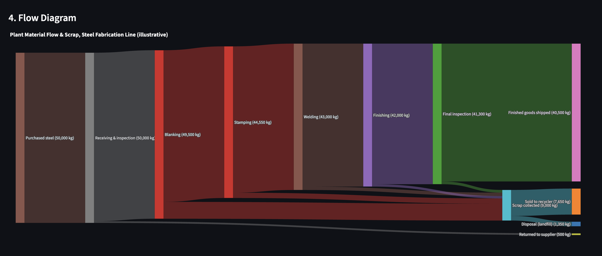
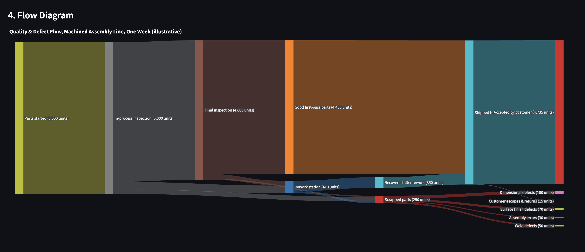
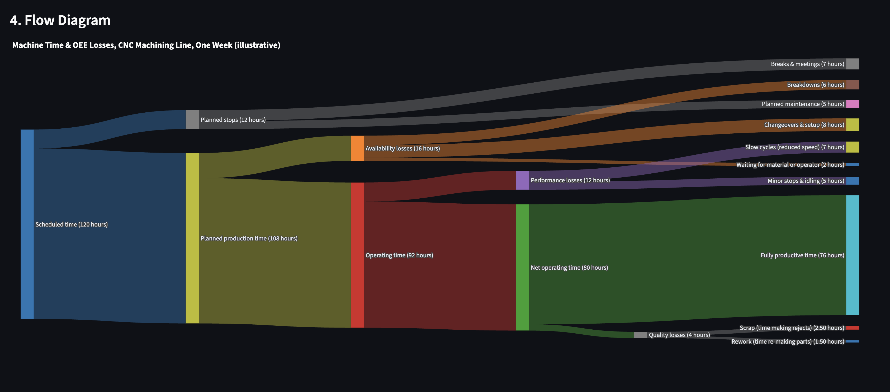
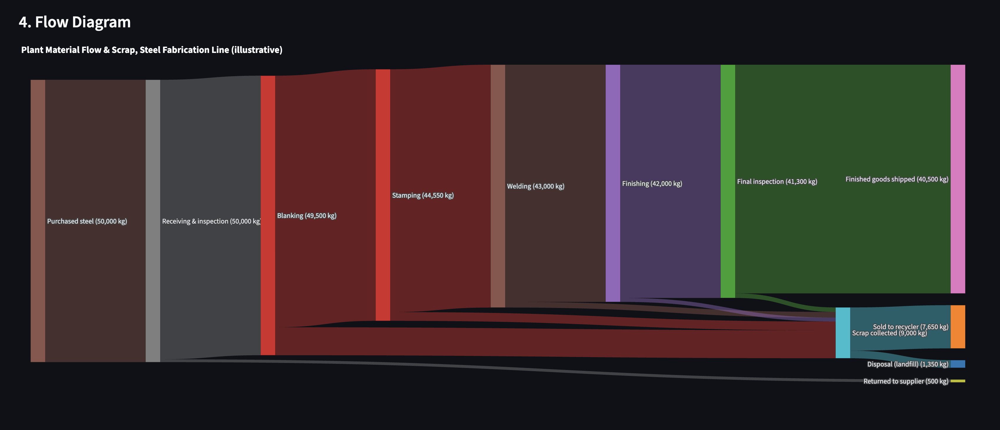

# 🔀 Flow Sankey Builder

**An interactive Sankey tool for tracing where material, energy, time, cost and parts go in a plant, and for checking that every stage balances.**

🔗 **Live app:** https://financial-sankey-builder-unkyenfc7ubcypvwyhbrwn.streamlit.app/

Built with Python, Pandas, Plotly and Streamlit.

> **All template data is illustrative.** The seven engineering templates and the sample budget are made-up example numbers chosen to show how the tool works. They are not measurements from a real plant, employer or project.



---

## Industrial problems it helps with

A Sankey diagram makes the biggest loss in a process visible at a glance, because link width is proportional to quantity. This tool builds one from a simple table of flows (Source, Target, Amount) and checks that what goes into each stage comes out.

| Problem | What the diagram shows |
|---|---|
| **Yield loss and scrap** | Where material leaves the line as scrap, rework or rejects, stage by stage |
| **Energy balance** | Where purchased energy ends up: useful work, distribution losses, idle and standby, waste heat |
| **OEE losses** | How scheduled hours shrink to fully productive time through availability, performance and quality losses |
| **Quality / defects** | How parts split into good first-pass, reworked, scrapped and customer returns |
| **Cost leakage** | How manufacturing cost splits into shipped product, scrap and rework, and other losses |
| **Supply chain flow** | How units move from suppliers through the plant and distribution centres to customers |

## Engineering templates

Choose one from **⚙️ Settings > Sample data set** and click **Load sample**. Each template sets the unit, chart title and node-name suggestions, and every one is marked *(illustrative)*.

| Template | Unit | What it shows | KPI tiles |
|---|---|---|---|
| **Plant material flow & scrap** | kg | 50,000 kg of steel through receiving, blanking, stamping, welding, finishing and final inspection; scrap collected at each stage and split between recycling and disposal | Overall yield, Scrap recovery |
| **Supply chain network** | units | Three suppliers, inbound freight, receiving, one plant, and two distribution centres, with direct shipping, returns and DC stock build-up | Share shipped direct, Inbound acceptance |
| **Plant energy flow** | MWh | Grid electricity and natural gas through distribution and utilities (boiler, compressed air, chilled water) to production areas and building services, with the losses | Share used in production, Boiler efficiency |
| **Machine / process energy balance** | kWh | One CNC machining centre over one shift: energy split across subsystems, ending as useful work or heat, friction and idle losses | Share doing useful work, Share lost to idle & standby |
| **Manufacturing cost flow** | $ | Materials, labour and overhead charged to work centres, ending as shipped product (COGS), inventory, scrap and rework, or other losses | Share shipped as good product, Share lost to scrap & rework |
| **Machine time / OEE losses** | hours | 120 scheduled hours on one machine line, down through planned stops and the three OEE loss categories to fully productive time | OEE, Availability |
| **Quality / defect flow** | units | 5,000 parts through in-process and final inspection: pass, rework or scrap, scrap by defect type, and customer escapes | First-pass yield, Final yield |

The app also includes a **Personal budget** sample (the default) and a **Blank canvas**. Because the unit is selectable ($, kWh, MWh, kg, tonnes, units, m³, hours, or a custom unit), the same tool works for any one-way flow.

## How it works

### Balance check
For every intermediate node (one that both receives and sends flow), the app compares inflow with outflow.

- If they match, it reports **"Every intermediate node is balanced."**
- If they do not, it lists each node with its inflow, outflow and the gap, so you can see exactly where material, energy or cost is unaccounted for.
- A node-by-node balance table is available in an expander.
- The totals **entering the system** (from pure sources) and **leaving the system** (to pure sinks) are always shown.
- Flows must be one-way. A loop (A → B → A) or a node feeding itself is rejected with a clear message.

Rework loops are therefore drawn one-way in the templates (see the Quality template notes).

### KPI tiles
Each template adds two tiles computed from the current flows, for example *overall yield = finished goods shipped ÷ material purchased*. They are recalculated whenever you edit the table, so you can test "what if scrap at stamping drops by half?" and watch the yield change. Hover over a tile for its definition. If you rename or delete a node a KPI depends on, that tile is simply hidden.

### Editing and entering data
- **Editable table:** double-click a cell to change it, tick a row and use the 🗑️ icon to delete, or use ➕ to add a row. Invalid edits are rejected and the table resets.
- **Add a flow:** pick a source and target from the dropdowns (which suggest names for the loaded template) or type new ones.
- **Math in the Amount box:** type `800+400` or `(5000-350)*0.2` and press Enter to get the result.
- **Chart image:** use the camera icon in the chart toolbar to save a PNG.

### CSV upload and download
- **📥 Download Data as CSV** saves the current flows with the columns `Source`, `Target`, `Value`.
- **📤 Upload a CSV** replaces the current flows with your own file in that format, so you can keep working on your own data across sessions.
- Files with missing columns, loops or invalid values are rejected with a message and **nothing is changed**.
- The CSV stores flows only, not the unit or chart title. Check both in Settings after uploading.

Example:

```csv
Source,Target,Value
Raw material,Machining,1000
Machining,Scrap,80
Machining,Finished parts,920
```

## Screenshots

| Quality / defect flow | Machine time / OEE losses |
|---|---|
|  |  |


*An edited flow that no longer balances: the app names the node and the size of the gap.*

## Run it locally

```bash
git clone https://github.com/GP26902/Financial-sankey-builder.git
cd Financial-sankey-builder
pip install -r requirements.txt
streamlit run app.py
```

## Run the tests

```bash
pip install -r requirements-dev.txt
pytest
```

The suite (228 tests) covers flow validation, loop detection, the balance check, the amount math parser, CSV parsing, KPI calculations, and loading each of the seven templates through the Streamlit app.

## Project structure

```
app.py              Streamlit interface (layout and user input only)
modules/
  flows.py          Validation, loop detection, balance check, math parser, CSV parsing
  kpis.py           Template KPI calculations
  presets.py        The seven engineering templates, personal budget, blank canvas
  chart.py          Plotly Sankey construction
  export.py         Image file naming
tests/              pytest suite
requirements.txt    Runtime dependencies
requirements-dev.txt  Test dependency
```

All calculation logic lives in `modules/` with no Streamlit dependency, which is why it can be tested on its own.

## Tech stack

Python · Pandas · Plotly · Streamlit · pytest · GitHub · Streamlit Community Cloud (auto-deploys from this repository)

## Limitations

- Flows are one-way (no loops), so recirculating streams such as rework are drawn as a single pass.
- Each template models one process, line or month with made-up numbers. Replace the data with your own measurements for real analysis.
- It shows where quantities go; it does not simulate or optimise a process.
